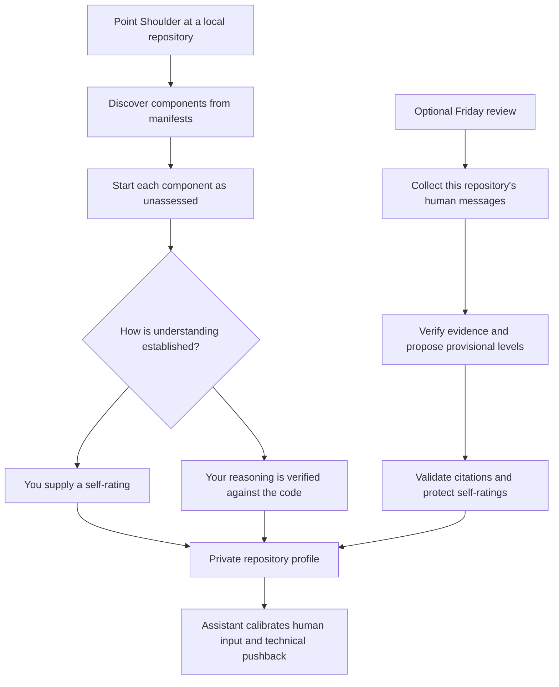

# Shoulder

Shoulder gives your coding assistant a private map of your understanding of a repository. During coding, it calibrates how much to rely on your domain judgment, how much context to explain, and how to push back on technical suggestions.

Point it at a local Git repository. It discovers components, starts their levels as **unassessed**, and uses explicit self-ratings or demonstrated understanding to calibrate collaboration.



## Get started

Install the `shoulder/` folder into your assistant's skills directory, then invoke:

```text
$shoulder point at /path/to/repo
$shoulder calibrate my understanding of /path/to/repo
```

The helper requires Python 3.11+, Git, and a POSIX environment such as macOS or Linux. Model-based reviews also require an authenticated Codex CLI. From the repository root, you can run the helper directly:

```sh
python3 shoulder/scripts/shoulder.py init --repo /path/to/repo
python3 shoulder/scripts/shoulder.py status --repo /path/to/repo
python3 shoulder/scripts/shoulder.py rate --repo /path/to/repo --unit apps/widget --score 3
python3 shoulder/scripts/shoulder.py review --repo /path/to/repo --timezone Europe/London --dry-run
```

Discovery checks supported manifests in `apps/`, `services/`, `packages/`, and `pkg/`: `package.json`, `go.mod`, `pyproject.toml`, and `Cargo.toml`. If it finds no components, it tracks the repository root. This is a starting inventory, not a complete architectural analysis.

## Where levels start

**It does not know your starting level.** A new component has no rating. Unassessed means insufficient evidence; level 1 means explicitly no knowledge.

You can supply a self-rating, or ask the assistant for a brief calibration conversation. For example, explain a component's request flow and a failure case. The assistant should check your explanation against the repository and keep any inferred rating provisional. Merely working on a component does not establish understanding.

| Level | What it means | How the assistant should collaborate |
| --- | --- | --- |
| Unassessed | No starting evidence | Explain context without assuming ignorance |
| 1 | Explicitly no knowledge | Explain fundamentals and investigate independently |
| 2 | Understands a basic component flow | Explain assumptions and the main tradeoffs |
| 3 | Understands an end-to-end flow and a tradeoff | Ask targeted questions and summarize decisions |
| 4 | Can diagnose failures and reason about boundaries | Seek domain judgment; keep routine explanations brief |
| 5 | Repeated architecture and operational reasoning, including unusual failures | Collaborate as domain peers and focus on novel constraints |

Your self-ratings stay protected until you change them. Automatic inference cannot overwrite them or lower an existing level. Levels describe familiarity, not authority: approval requirements, testing, and verification still apply.

## Human trust and pushback during coding

At a lower level, the assistant investigates assumptions independently and explains concerns in context. At a higher level, it gives more weight to your demonstrated domain judgment and asks whether a conflict reflects missing context. It should still challenge verified defects at every level.

For example, if you suggest removing a retry, an assistant at level 2 should explain the failure path and verify why the retry exists. At level 5, it can ask a concise question about the retry's operational purpose. In both cases, the current code and observed behavior still need verification.

Levels do not measure your general ability or the probability that any claim is correct. Confidence and known gaps qualify the level for each topic. High levels must not cause blind agreement; low levels must not cause reflexive pushback. Product preferences and explicit authorization remain yours.

## Friday reviews

When authorized, configure your scheduler to run the `review` command every Friday at 17:00 in your chosen timezone. The skill does not install a scheduler automatically. Test the command with `--dry-run` first; remove that flag to perform a review.

Each review examines the latest completed Monday 00:00 to Friday 17:00 window. It selects human messages from local Codex and Claude sessions belonging to the selected repository, checks technical reasoning against the code, and validates proposed ratings before saving them. Successful weeks are not reviewed twice; three failed attempts stop retries for that week.

An explanation or correction can provide evidence. “Ship it,” pasted review comments, commit counts, and code written by an agent cannot. Ambiguous authorship earns no learning credit. Reviews record confidence, reasons, gaps, assessment times, and source references. Inferred ratings remain estimates you can correct.

Collection is bounded and may omit work. Coverage records skipped messages and truncation. Deleted worktrees or unknown session formats may prevent repository matching. The timezone defaults to UTC unless you specify one.

## Privacy

Git worktrees share the repository's profile; unrelated repositories never match by basename. Profiles stay local, outside the checkout and installed skill.

Public files contain the skill, helper and synthetic tests. Private profiles live in `~/.local/state/shoulder/`, keyed by canonical Git common-directory identity. Local session history and dry-run evidence are private and must not be published. Model-based reviews send selected human messages and relevant verification context to the evaluator model when authorized; they are not an offline analysis.

Run tests with `python3 -m unittest discover -s shoulder/tests`.
